# Illustrated SysML collaboration walkthrough

This walkthrough shows the actual fixed water-tank demo, captured from an isolated local run. It starts with a model already loaded. The current PoC supports scalar edits and additions, but it does **not** provide project creation, adding parts or drawing connections; the controller, pump, tank and three connections come from the reference fixture. The screenshots show the supported equivalents of those steps.

## Before you begin

Install the prerequisites in [the README](../README.md#run) and run `task setup` if needed. For a disposable walkthrough, use a new data directory and a free port in PowerShell, from the project root:

```powershell
$env:SYSML_PORT = '14317'
$env:SYSML_DATA_DIR = Join-Path $env:TEMP ('sysml-walkthrough-' + [guid]::NewGuid().ToString())
task run
```

Open `http://127.0.0.1:14317` in two browser tabs. Keep the same PowerShell environment and data directory when restarting. Use a different free port if 14317 is occupied. **Reset discards both actors’ work and history in the selected data directory**; use it only with disposable data.

## 1. Open the app

The starting screen shows the `system` diagram and Alice’s view. Click **1 Reset** and confirm to initialize the scripted sequence. Wait for **2 Alice edits** to become active.

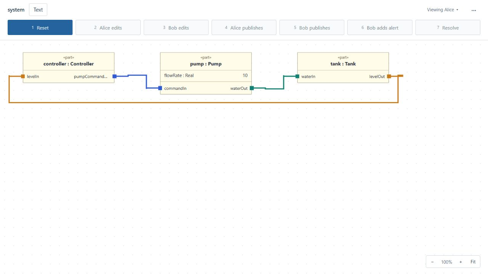

## 2. Open the sample model

The sample is loaded automatically; there is no project chooser or new-project action. Click **Text** to see its SysML source alongside the diagram, then close the source pane. The model is defined in [water-tank.sysml](../fixtures/water-tank.sysml).

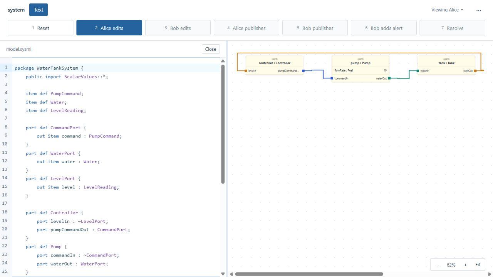

## 3. Edit a model property

Click **2 Alice edits**. Alice’s local `pump.flowRate` changes from `10` to `12`; the message states that it has not yet been published. This edits an existing part; adding a new part through the diagram is not supported.

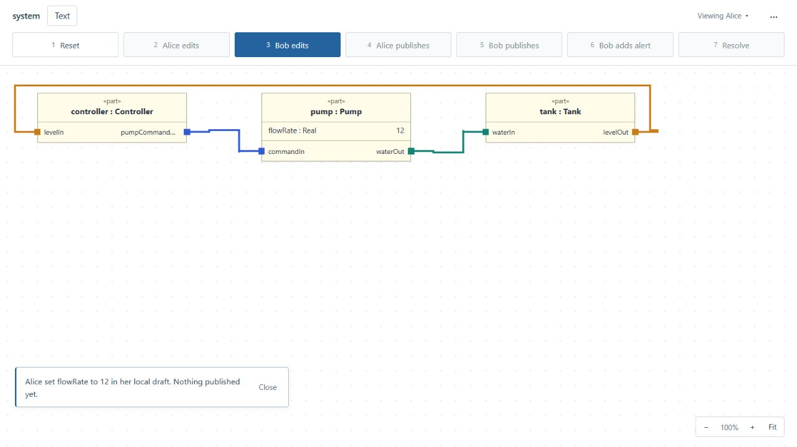

## 4. Inspect existing elements and connections

The sample already connects controller → pump → tank → controller. Follow the colored lines and double-click the pump’s `waterOut` port to inspect the `Pump` definition. Creating a second part or connecting parts interactively is not supported by this PoC; this screenshot shows an existing port instead.

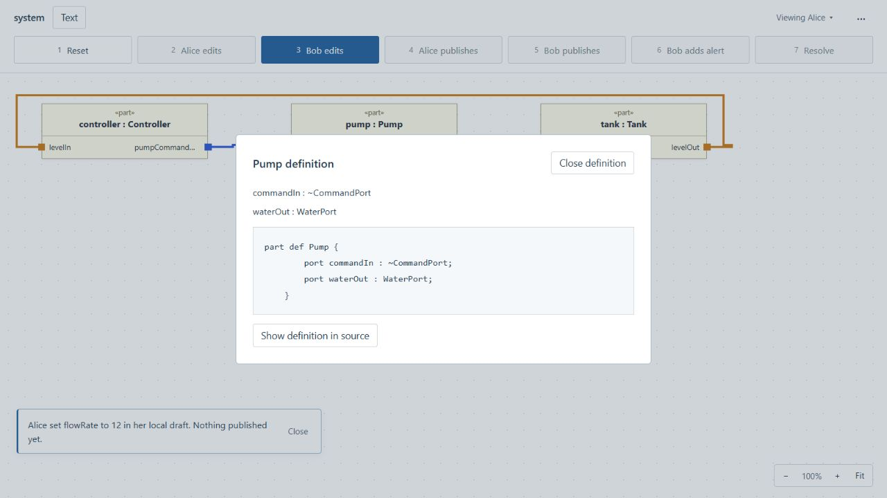

## 5. Navigate between diagram and source

In the definition dialog, click **Show definition in source**. The source pane opens at the selected `Pump` definition. Close the source pane to return to the full diagram.

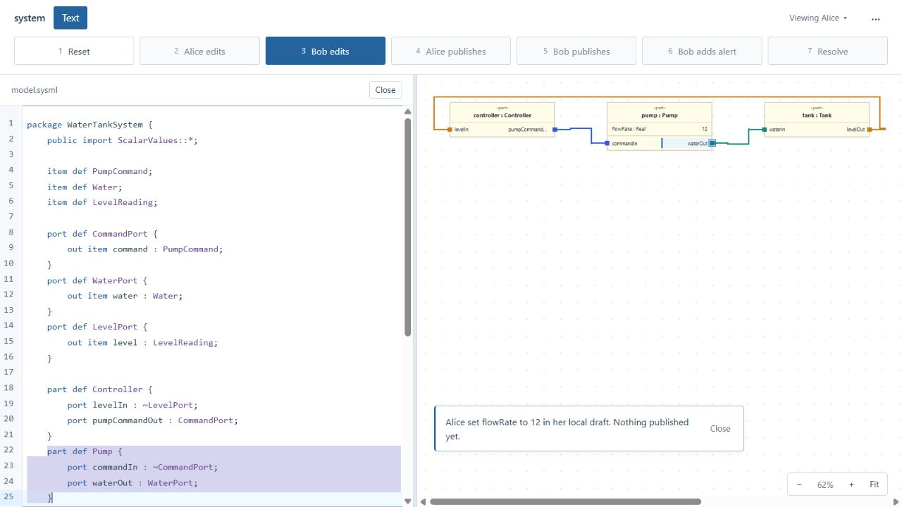

## 6. Collaborate in two sessions

1. In the first tab click **3 Bob edits**. The app switches to Bob, whose independent draft has `flowRate = 15`.

   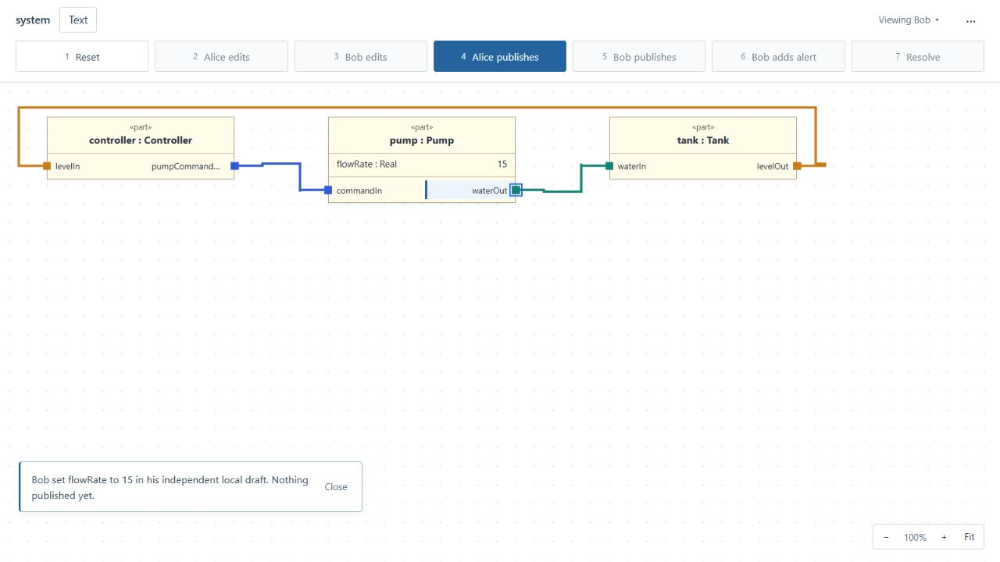

2. In the second tab, use **Viewing** to select Alice if needed. Her separate draft shows `12`. Click **4 Alice publishes** and wait for completion.

   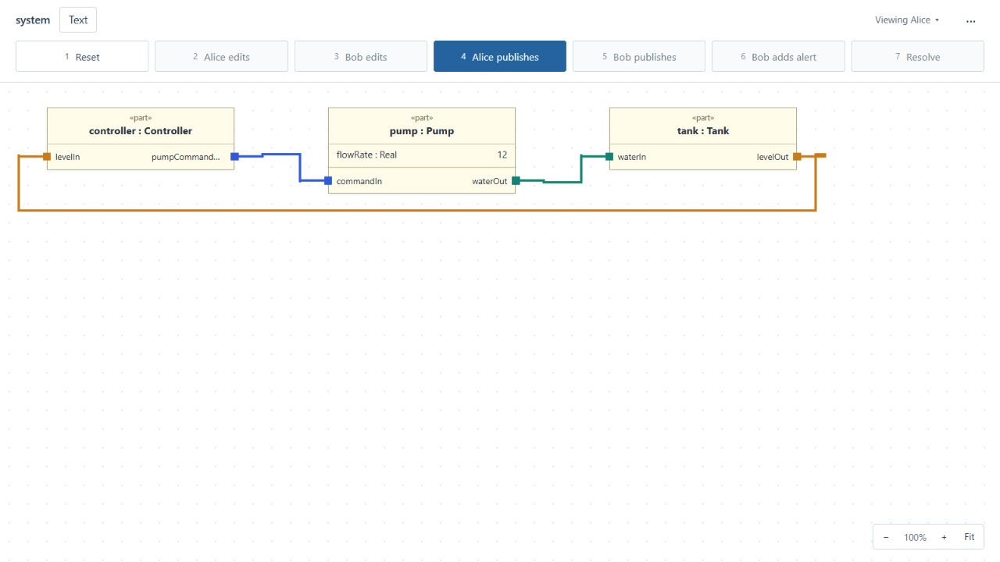

3. Return to Bob’s tab and click **5 Bob publishes**. The pump block gets a red border and its `flowRate` row is marked as conflicted; the shared model remains at Alice’s `12` until resolution. A selected block also keeps its blue selection outline. Click the conflicted row to inspect base `10`, incoming `12`, and Bob’s provisional `15`; choose **Cancel proposal** to continue the scripted sequence.

   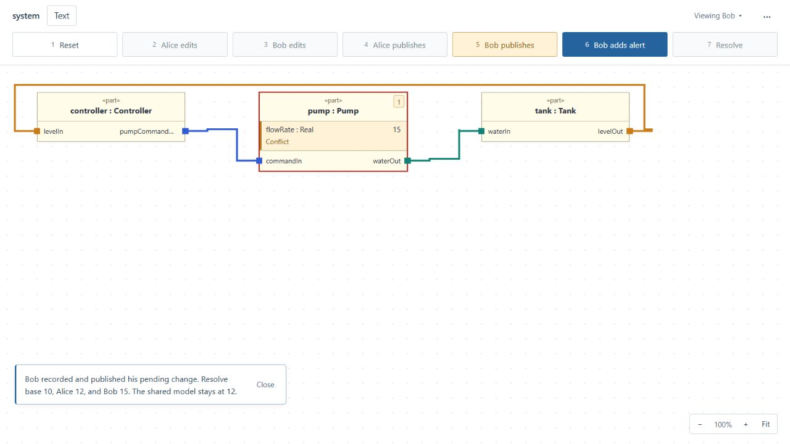

   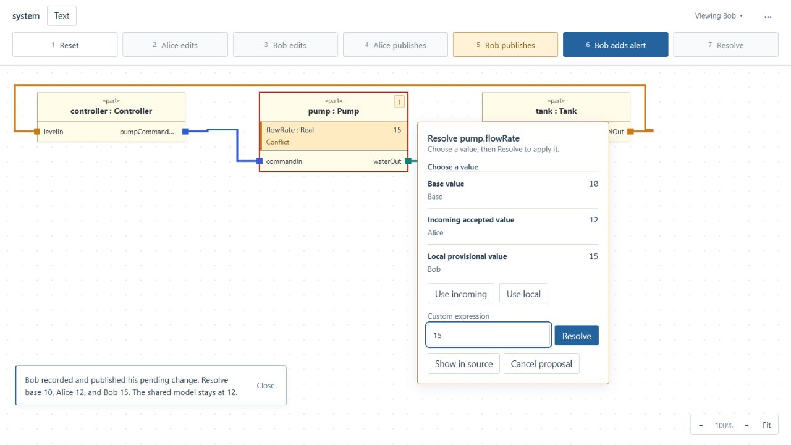

4. Click **6 Bob adds alert**. This adds the scalar `alertEnabled = true` while the conflict remains. Then click **7 Resolve**. The shortcut resolves `flowRate` to `14`, publishes Bob’s changes, and preserves the later alert. Once resolved, the red border disappears.

   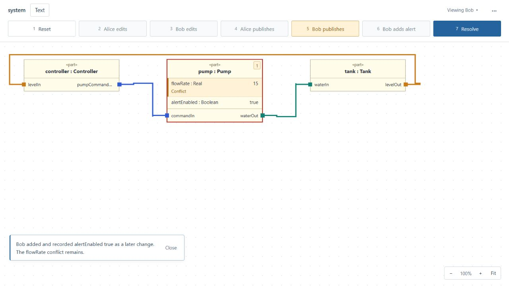

   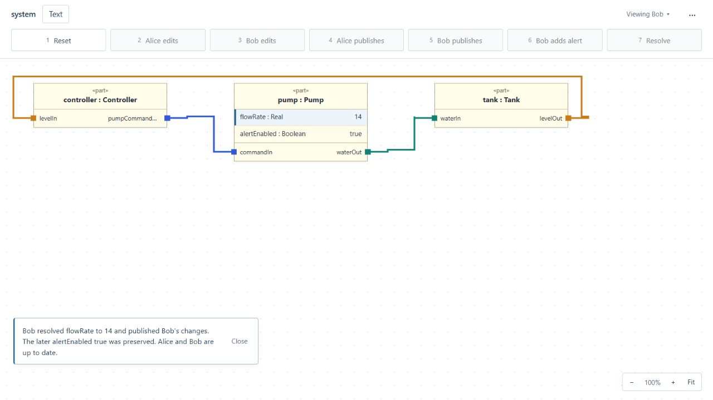

5. Refresh Alice’s tab. It shows the same `14` and `true`. The screenshot reflects a refresh; it does not claim that an already-open tab updates immediately without one.

   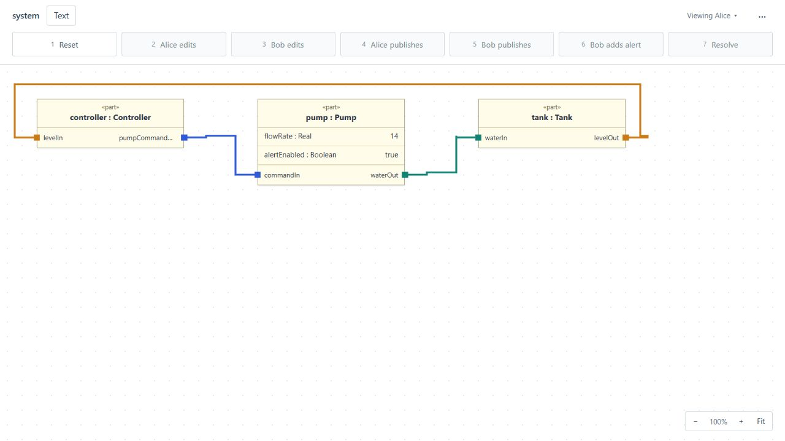

## 7. Reopen the saved result

The PoC saves its workspace state locally; there is no separate Save button or project-file picker. Stop the server with Ctrl+C, then run `task run` again in the same PowerShell environment with the same `SYSML_DATA_DIR`. Reopen or refresh Alice’s tab. `flowRate = 14` and `alertEnabled = true` remain after the server restart. Do not press Reset unless you intend to discard the demo state.


For the underlying seven-step sequence and additional limitations, see the [demo walkthrough](demo.md).
